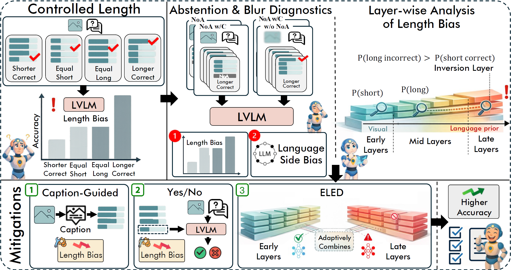
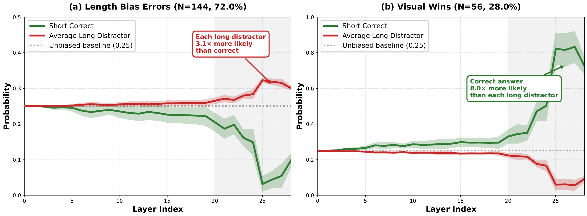

# Investigating Length Bias and Robustness in LVLMs for Multiple-Choice Question Answering

<p align="center">
  <a href="https://aclanthology.org/2026.emnlp-main.2559/"></a>
  <a href="https://aclanthology.org/2026.emnlp-main.2559.pdf"></a>
  
    <a href="Datasets/"></a>
</p>

<p align="center">
  <b>Md. Atabuzzaman</b>, <b>Hani Alomari</b>, <b>Chris Thomas</b><br>
  Department of Computer Science, Virginia Tech<br>
  <b>EMNLP 2026 (Main Conference)</b>
</p>

<p align="center">
  
</p>
<p align="center"><em>Overview of our framework: length-controlled MCQA variants, layer-wise analysis of where length bias emerges, abstention and blur diagnostics, and inference-time mitigation strategies.</em></p>

## Abstract

Large Vision-Language Models (LVLMs) demonstrate strong performance on multiple-choice question answering (MCQA), yet their reliability under biased conditions remains underexplored. We investigate length bias, the systematic preference for longer answer options, through controlled benchmarks spanning fine-grained visual domains. LVLMs consistently favor longer options even when visually inconsistent, with accuracy dropping 2–38% when correct answers are shorter and increasing 1–70% when longer. This bias persists across model scales. Through layer-wise mechanistic analysis, we reveal that length bias emerges from late-layer suppression of visual evidence in favor of language-side length priors. Blurry-image experiments show that bias intensifies when visual evidence weakens, while abstention tests reveal that LVLMs struggle to refuse incorrect predictions. We propose and evaluate multiple inference-time mitigation strategies; while these provide partial improvements, none achieves deployable bias mitigation without relying on oracle information unavailable at inference time. These results underscore that inference-time interventions are insufficient, pointing to the need for architectural solutions and bias-aware training.

## Vision–Language Conflict in Late Layers

<p align="center">
  
</p>
<p align="center"><em>Layer-wise probabilities for the short correct answer versus the average long distractor (Qwen2.5-VL-7B, Shorter Correct split). In length-biased errors, late layers amplify long distractors and suppress the correct answer; when the model is correct, the same layers amplify the correct answer instead.</em></p>

## Dataset

The length-controlled MCQA benchmark is available in [`Datasets/`](Datasets/). It covers five fine-grained visual domains: CUB-200-2011, Stanford Dogs, FGVC Aircraft, Stanford Cars, and Food-101. Each question has four length-controlled variants: **Equal Long**, **Equal Short**, **Shorter Correct**, and **Longer Correct**.

Files follow the pattern `len_bias_variants_<domain>_hard_<setting>.json`:
- `with_name`: answer options include the class name
- `wo_name`: answer options contain only visual descriptions
- `_easy` (CUB and Dogs): easy-difficulty questions with distractors from unrelated classes

## Code

Code is **coming soon**.

## Citation

If you find this work useful, please cite:

```bibtex
@inproceedings{atabuzzaman2026investigating,
    title = "Investigating Length Bias and Robustness in {LVLM}s for Multiple-Choice Question Answering",
    author = "Atabuzzaman, Md.  and Alomari, Hani  and Thomas, Chris",
    booktitle = "Proceedings of the 2026 Conference on Empirical Methods in Natural Language Processing",
    month = oct,
    year = "2026",
    address = "Budapest, Hungary",
    publisher = "Association for Computational Linguistics",
    url = "https://aclanthology.org/2026.emnlp-main.2559/",
    pages = "58157--58176"
}
```
